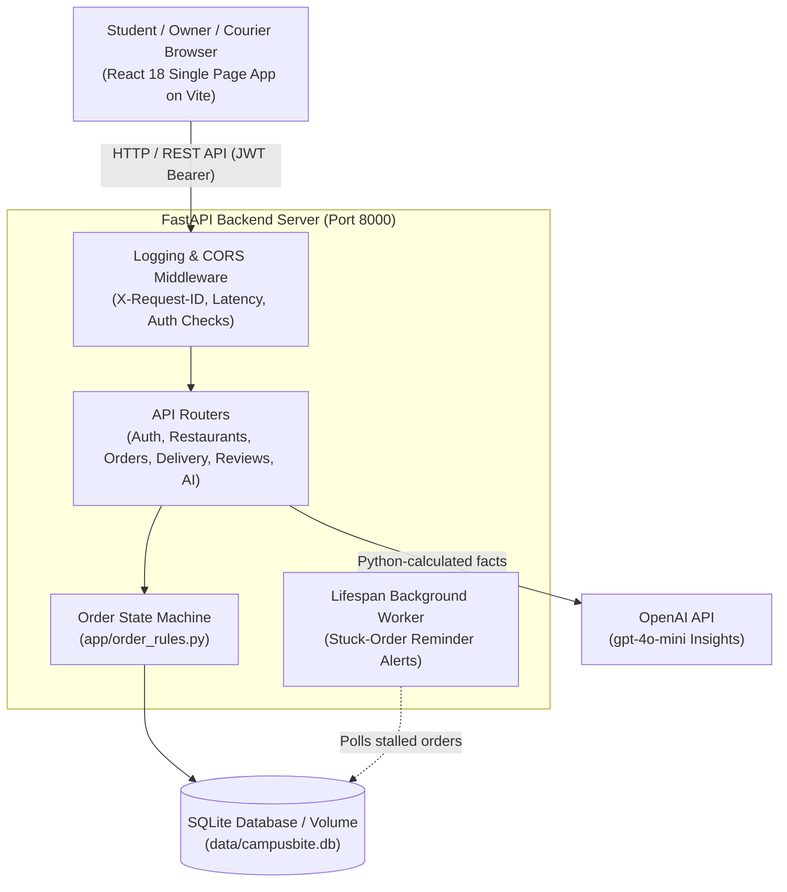
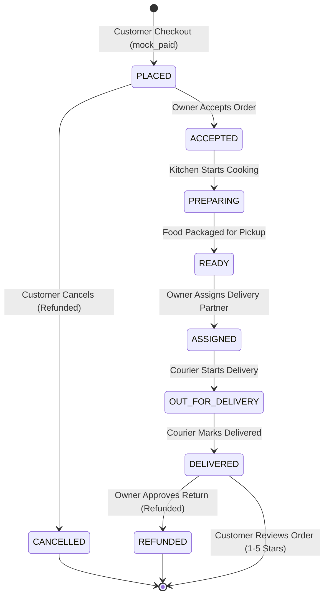

# CampusBite — University Food Ordering & Delivery Platform

[](https://fastapi.tiangolo.com)
[](https://react.dev)
[](https://vitejs.dev)
[](https://www.python.org)
[](https://www.docker.com)
[](LICENSE)

---

## 1. Project Overview

**CampusBite** is a full-stack web application designed specifically for university campus communities to connect student diners, campus canteen kitchens, and student couriers. It streamlines the entire dining workflow: students browse menus from campus canteens and track their deliveries live; restaurant owners manage kitchen prep tickets and menu availability with a strict Single Valid Action lifecycle; and student delivery partners earn on campus by fulfilling delivery routes with mobile-friendly order controls. All financial records are tracked in an immutable audit ledger, and customers can explore their historical dining habits using an AI order insights engine powered by OpenAI.

---

## 2. Features by Role

### 🎓 Customer (Student / Faculty)
- **Canteen Directory**: Search campus food stalls with 400ms debounced search and typographic brand monograms.
- **Menu Browsing & Filters**: Explore dish listings with minimum and maximum price bracket filters.
- **Single-Restaurant Cart**: Smart cart with quantity controls and conflict warnings when adding items from multiple kitchens.
- **Simulated University Ledger Checkout**: Secure order placement with student delivery destination validation and simulated payment ledger recording.
- **Live Order Tracking**: Visual 7-step lifecycle timeline (`PLACED` ➔ `DELIVERED`) with lightweight 15-second polling that automatically terminates when orders reach final states.
- **Order Cancellation**: Free one-click cancellation with immediate automated ledger refund while the order is in `PLACED` status.
- **Ratings & Reviews**: 1-to-5 star rating picker with optional feedback comments on delivered orders (exactly 1 review per order; blocked on refunded orders).
- **Return & Refund Requests**: File return requests with required 5+ character reason validation.
- **AI Order Insights**: Natural-language meal analytics with 4 quick sample prompts, 300-character input counter, and plain-text safe rendering.

### 👨‍🍳 Restaurant Owner (Canteen Vendor)
- **Live Business Dashboard**: Real-time KPI summary cards (revenue from delivered meals, total orders, average rating, active orders), 30-second live auto-refresh, and top bestselling dishes.
- **Kitchen Order Management**: Enforces the **Single Valid Action** pattern (`PLACED` ➔ `ACCEPTED` ➔ `PREPARING` ➔ `READY`) to prevent kitchen misclicks, with courier assignment dropdown for ready meals.
- **Menu Management**: Modal for dish creation, real-time price updates, one-click in-stock / out-of-stock toggles, and soft-delete protections for dishes with order history.
- **Return Request Decisions**: Review student return requests with side-by-side Approve (triggers automated ledger refund) or Reject actions.
- **Stuck-Order Reminders**: Integrated alert banners identifying orders lingering too long in preparation.

### 🚴 Delivery Partner (Student Courier)
- **Courier Operations Hub**: Mobile-first design optimized for handheld smartphone use while walking or cycling on campus.
- **Active & History Tabs**: Separate queues for active deliveries (`ASSIGNED`, `OUT_FOR_DELIVERY`) and completed trips (`DELIVERED`).
- **Touch-Friendly Controls**: Prominent buttons (minimum 48px touch targets) to "Start Delivery" and "Mark Delivered" with confirmation prompts.
- **Route Information**: Immediate visibility of canteen pickup locations, student dorm drop-off addresses, and order items.

### ⚙️ Core Platform & Middleware
- **Auditable Logging Middleware**: Generates unique `X-Request-ID` UUIDs, measures latency in milliseconds (`X-Process-Time-ms`), logs sanitized access records to `logs/app.log`, and catches unhandled exceptions with clean JSON 500 responses.
- **Background Stuck-Order Worker**: Asynchronous background task running on the FastAPI lifespan that identifies stalled orders every 60 seconds without creating duplicate alerts.
- **Production Secret Key Gate**: Automatically verifies that `SECRET_KEY` is not missing or set to placeholder defaults when `APP_ENV=production`.

---

## 3. Technologies Used

| Technology | Layer | Reason for Selection |
|------------|-------|----------------------|
| **FastAPI** | Backend Web Framework | High-performance asynchronous Python framework with automatic Swagger documentation and native Pydantic validation. |
| **SQLAlchemy** | Database ORM | Robust object-relational mapping supporting clean schema migrations, cascading relationships, and database portability (SQLite to PostgreSQL). |
| **SQLite** | Local Database | Zero-configuration serverless SQL database perfect for lightweight development, local testing, and Docker volume persistence. |
| **Pydantic v2** | Data Validation | Strict schema validation, automatic serialization, and descriptive error messages for API inputs and outputs. |
| **Bcrypt & PyJWT** | Security & Auth | Industry-standard password hashing with individual salt generation and stateless HMAC-SHA256 JWT tokens. |
| **React 18** | Frontend Library | Declarative component hierarchy and fast state reconciliation for reactive live tracking interfaces. |
| **Vite 5** | Frontend Bundler | Sub-second Hot Module Replacement (HMR) and optimized Rollup production builds with dead-code elimination. |
| **React Router v6** | Client Routing | Declarative single-page application routing with role-based `ProtectedRoute` guards. |
| **Axios** | HTTP Client | Centralized HTTP request handling with automatic JWT Bearer injection and 401 session logout interceptors. |
| **Lucide React** | Icons | Modern, lightweight, accessible SVG iconography without framework dependencies. |
| **OpenAI Python SDK** | AI Insights Engine | Low-latency natural language summarization (`gpt-4o-mini`) with Python-side arithmetic pre-computation. |
| **Docker & Docker Compose** | Containerization | Standardized, multi-platform container orchestration with named volume data persistence and healthchecks. |

---

## 4. Architecture Diagrams

### System Architecture


### Order State Lifecycle Machine


---

## 5. Project Structure

```
CampusBite/
├── docker-compose.yml              # Multi-container orchestration specification
├── README.md                       # Comprehensive project documentation
├── PHASE8_MASTER_PROMPT.md         # Final phase specifications
├── scripts/
│   └── verify_phase7b_e2e.py       # Full 11-scenario automated E2E test suite
├── backend/
│   ├── Dockerfile                  # Slim Python 3.11 container definition
│   ├── .dockerignore               # Container build exclusions
│   ├── .env.example                # Sanitized environment template
│   ├── pytest.ini                  # Pytest test configuration
│   ├── requirements.txt            # Python dependencies
│   ├── seed_demo_users.py          # Idempotent demo data seeder
│   ├── app/
│   │   ├── main.py                 # FastAPI application factory & lifespan
│   │   ├── database.py             # SQLAlchemy engine & session maker
│   │   ├── models.py               # Database ORM models & relationships
│   │   ├── schemas.py              # Pydantic request & response schemas
│   │   ├── auth.py                 # Bcrypt hashing & JWT verification
│   │   ├── order_rules.py          # Authoritative state machine transitions
│   │   ├── middleware.py           # Request ID, process time & access logger
│   │   ├── reminders.py            # Background stuck-order detector
│   │   ├── ai_insights.py          # OpenAI summarizer with Python arithmetic
│   │   └── routers/                # Domain-specific route controllers
│   └── tests/                      # 55 automated backend tests
├── frontend/
│   ├── index.html                  # HTML entry point
│   ├── vite.config.js              # Vite configuration
│   ├── .env.example                # Frontend environment template
│   ├── src/
│   │   ├── main.jsx                # React DOM mount point
│   │   ├── App.jsx                 # Route definitions & guards
│   │   ├── api/                    # Axios API client modules
│   │   ├── context/                # AuthContext & CartContext
│   │   ├── hooks/                  # usePaginatedList custom hook
│   │   ├── components/             # Reusable UI widgets & status badges
│   │   ├── pages/                  # Customer, Owner, & Courier views
│   │   └── styles/                 # Hallmark CSS design tokens
└── project-docs/                   # Capstone reports, guides & viva notes
    ├── BUILD_LOG.md                # Dated chronological build log
    ├── STATUS.md                   # Project verification status
    ├── MEMORY.md                   # Architectural decisions log
    ├── GITHUB_PUSH_GUIDE.md        # Publishing guide for GitHub
    ├── DEMO_SCRIPT.md              # 7-minute viva presentation plan
    ├── SUBMISSION_CHECKLIST.md     # Capstone requirements audit
    ├── FRONTEND_TEST_CHECKLIST.md  # 21-scenario walkthrough audit
    ├── VIVA_QUESTIONS.md           # Technical viva defense Q&A
    └── LEARNING_NOTES.md           # Five-year-old conceptual analogies
```

---

## 6. Environment Variables

### Backend (`backend/.env`)

| Variable | Required | Default / Placeholder | Description |
|----------|:--------:|-----------------------|-------------|
| `APP_ENV` | No | `development` | Set to `production` in live containers to enforce secret safety. |
| `DATABASE_URL` | Yes | `sqlite:///./campusbite.db` | SQLAlchemy connection string (overridden to `/data/campusbite.db` in Compose). |
| `SECRET_KEY` | Yes | `change-me` | 32+ char secret for signing JWT tokens. Refuses startup if default in production. |
| `ALGORITHM` | No | `HS256` | JWT cryptographic signature algorithm. |
| `ACCESS_TOKEN_EXPIRE_MINUTES` | No | `1440` | JWT token validity window in minutes (1440 = 24 hours). |
| `OPENAI_API_KEY` | Optional | `change-me` | API key for AI order insights. If missing, app returns polite notices. |
| `OPENAI_MODEL` | No | `gpt-4o-mini` | OpenAI language model for order summaries. |
| `REMINDERS_ENABLED` | No | `true` | Enables background worker detecting stalled orders. |
| `REMINDER_THRESHOLD_MINUTES` | No | `15` | Minutes an order can remain in state before triggering reminder. |
| `REMINDER_CHECK_SECONDS` | No | `60` | Frequency in seconds of background reminder scans. |
| `CORS_ORIGINS` | Yes | `http://localhost:5173` | Comma-separated list of allowed frontend web origins. |

### Frontend (`frontend/.env`)

| Variable | Required | Default / Placeholder | Description |
|----------|:--------:|-----------------------|-------------|
| `VITE_API_URL` | Yes | `http://localhost:8000` | Backend API base address called by Axios client. |
| `VITE_SHOW_DEMO_LOGINS` | No | `false` | When `true`, displays 1-click evaluation shortcuts on login screen. |

---

## 7. Run the Backend with Docker Compose

Ensure Docker and Docker Compose are installed and running on your system.

### 1. Configure Environment
```bash
# From the repository root, copy the template
cp backend/.env.example backend/.env

# Edit backend/.env and provide a random 32+ character SECRET_KEY
```

### 2. Build and Start Container
```bash
# Build the container image
docker compose build

# Start the container in detached mode
docker compose up -d
```

### 3. Seed Demo Accounts & Sample Menu Items
```bash
# Run the database seeder inside the running container
docker compose exec backend python seed_demo_users.py
```

### 4. Verify Health & Logs
```bash
# Check container status and health
docker compose ps

# View live application logs
docker compose logs -f backend
```

### 5. Stopping and Data Persistence
```bash
# Stop containers (database remains preserved in named volume campusbite-data)
docker compose down

# Restart containers; past orders and accounts will persist
docker compose up -d
```

---

## 8. Run the Frontend Locally

### 1. Install Dependencies
```bash
cd frontend
npm install
```

### 2. Configure Environment
```bash
# Copy frontend template
cp .env.example .env

# To show evaluation demo login buttons, set VITE_SHOW_DEMO_LOGINS=true
```

### 3. Launch Development Server
```bash
npm run dev
```
Open your browser to: **`http://localhost:5173`**

---

## 9. Run the Backend Without Docker (Native Python)

If you prefer running the backend directly on your computer:

```bash
cd backend

# 1. Create and activate a Python 3.11 virtual environment
python -m venv .venv
# On Windows:
.venv\Scripts\activate
# On Linux/macOS:
source .venv/bin/activate

# 2. Install dependencies
pip install -r requirements.txt

# 3. Create .env configuration
cp .env.example .env

# 4. Seed initial demo data
python seed_demo_users.py

# 5. Start development server
python -m uvicorn app.main:app --host 127.0.0.1 --port 8000 --reload
```
API Documentation will be live at: **`http://127.0.0.1:8000/docs`**

---

## 10. Database Setup & Schema

The database tables are automatically generated on application startup via SQLAlchemy's `Base.metadata.create_all(bind=engine)` inside the lifespan context manager.

### Entity Relationships in Plain Words:
- **`users`**: Stores accounts across three roles: `customer`, `restaurant_owner`, `delivery_partner`.
- **`restaurants`**: Owned by a `restaurant_owner` (`owner_id` foreign key).
- **`menu_items`**: Belongs to a restaurant with price and availability toggles (`is_available`).
- **`orders`**: Connects a `customer_id`, a `restaurant_id`, and an assigned `delivery_partner_id`.
- **`order_items`**: Line items containing `menu_item_id`, quantity, and an immutable `price_at_order` snapshot.
- **`reviews`**: Exactly one customer rating (1-5 stars) and comment per delivered order (`unique=True` on `order_id`).
- **`payment_ledgers`**: Double-entry style append-only record tracking initial purchases (`mock_payment`) and approved refunds (`refund`).
- **`admin_reminder_logs`**: Historical audit log recording background stuck-order alerts.

### Resetting the Database:
- **Docker**: Run `docker compose down -v` to delete containers and named volumes, then run `docker compose up -d` and re-seed.
- **Local**: Delete `backend/campusbite.db` and re-run `python seed_demo_users.py`.

---

## 11. Demo Accounts

The following demo accounts are seeded for evaluation and testing purposes:

| Role | Email | Password | Intended Workflow |
|------|-------|----------|-------------------|
| **Customer** | `customer@campusbite.com` | `password123` | Browsing menus, placing orders, writing reviews, AI queries. |
| **Customer (Alt)** | `student1@campusbite.com` | `password123` | Secondary student account for multi-customer testing. |
| **Restaurant Owner** | `owner1@campusbite.com` | `password123` | Manages "Mario's Campus Pizzeria", kitchen orders, and returns. |
| **Delivery Partner** | `delivery@campusbite.com` | `password123` | Student courier picking up orders and completing drop-offs. |

*(Note: These accounts are for local testing and demonstration only).*

---

## 12. API Documentation

Interactive API documentation is generated automatically by FastAPI:
- **Swagger UI**: [`http://127.0.0.1:8000/docs`](http://127.0.0.1:8000/docs)
- **ReDoc UI**: [`http://127.0.0.1:8000/redoc`](http://127.0.0.1:8000/redoc)

### Route Summary Table

| Method | Endpoint | Authorized Roles | Description |
|--------|----------|:----------------:|-------------|
| `GET` | `/health` | Public | System health check reporting database and timestamp status. |
| `POST` | `/auth/register` | Public | Register a new account (`customer`, `restaurant_owner`, `delivery_partner`). |
| `POST` | `/auth/login` | Public | Authenticate with email/password; returns JWT access token. |
| `GET` | `/auth/me` | Authenticated | Retrieve current user profile from JWT claims. |
| `GET` | `/restaurants` | Public | List paginated restaurants with search query. |
| `GET` | `/restaurants/{id}` | Public | Retrieve single restaurant profile details. |
| `GET` | `/restaurants/{id}/menu` | Public | List menu dishes (customers see available only; owners see all). |
| `POST` | `/restaurants` | `restaurant_owner` | Register a new restaurant profile. |
| `PUT` | `/restaurants/{id}` | `restaurant_owner` | Update owned restaurant profile details. |
| `POST` | `/restaurants/{id}/menu` | `restaurant_owner` | Add a new menu item to owned canteen. |
| `PUT` | `/menu-items/{id}` | `restaurant_owner` | Update dish details (name, description, price). |
| `PATCH` | `/menu-items/{id}/availability` | `restaurant_owner` | Toggle dish availability (in stock vs sold out). |
| `DELETE` | `/menu-items/{id}` | `restaurant_owner` | Delete dish (soft-deletes if order history exists). |
| `POST` | `/orders` | `customer` | Place a new meal order; recalculates prices and creates ledger. |
| `GET` | `/orders` | `customer` | List personal order history with status and date filters. |
| `GET` | `/orders/{id}` | Order Participants | Retrieve single order details and line items. |
| `POST` | `/orders/{id}/cancel` | `customer` | Cancel order in `PLACED` state with instant ledger refund. |
| `PATCH` | `/orders/{id}/status` | `restaurant_owner` | Advance kitchen state (`ACCEPTED`, `PREPARING`, `READY`). |
| `PATCH` | `/orders/{id}/assign` | `restaurant_owner` | Assign a delivery partner to a ready order (`ASSIGNED`). |
| `GET` | `/owner/orders` | `restaurant_owner` | List orders for owned restaurant with filters. |
| `GET` | `/owner/stats` | `restaurant_owner` | Retrieve sales revenue, orders count, and rating metrics. |
| `GET` | `/owner/delivery-partners` | `restaurant_owner` | List available courier accounts for assignment. |
| `GET` | `/owner/reminders` | `restaurant_owner` | List stuck-order reminder alerts. |
| `GET` | `/delivery/orders` | `delivery_partner` | List assigned active deliveries and completed history. |
| `PATCH` | `/delivery/orders/{id}/status`| `delivery_partner` | Advance delivery to `OUT_FOR_DELIVERY` or `DELIVERED`. |
| `POST` | `/orders/{id}/review` | `customer` | Submit 1-to-5 star rating and comment for delivered order. |
| `GET` | `/restaurants/{id}/reviews` | Authenticated | List paginated reviews for a restaurant with average rating. |
| `POST` | `/orders/{id}/return` | `customer` | Submit return request with 5+ character reason. |
| `GET` | `/owner/returns` | `restaurant_owner` | List pending customer return requests for owned canteen. |
| `PATCH` | `/orders/{id}/return/decision`| `restaurant_owner` | Approve (triggers ledger refund) or reject return request. |
| `POST` | `/ai/insights` | `customer` | Query natural-language dining analytics via OpenAI. |

---

## 13. Authentication and Authorization

CampusBite enforces strict multi-role defense in depth:
1. **Password Hashing**: Passwords are never stored in plaintext. They are salted and hashed using native `bcrypt` (`bcrypt.gensalt()`).
2. **Stateless JWT Claims**: Upon successful login, the backend issues an HMAC-SHA256 signed JSON Web Token containing the user's ID, email, and role.
3. **Server-Side RBAC Enforcement**: While the React frontend provides friendly client routing via `<ProtectedRoute>`, the FastAPI backend is the ultimate authority. Every sensitive route uses FastAPI dependencies (`Depends(require_role("restaurant_owner"))`) that decode the JWT signature and raise HTTP 403 Forbidden if the token role does not match.

---

## 14. AI Order Insights Feature

- **Customer Data Privacy**: The `/ai/insights` endpoint identifies the caller solely via `current_user.id` from their cryptographically validated JWT. It queries only that customer's past orders (up to 50 most recent). It is impossible for Customer A to query Customer B's records.
- **Python Arithmetic vs. LLM Hallucinations**: Large language models frequently fail at accurate financial arithmetic. CampusBite calculates all totals, counts, and top dishes in Python (`calculate_order_facts`) and passes verified mathematical facts into the prompt data block.
- **Prompt Injection Defense**: Customer questions are wrapped inside strict delimiter blocks (`<user_question>...</user_question>`) with instructions forbidding system prompt overrides or financial recalculations.
- **Rate Limiting**: An in-memory sliding window rate limiter restricts each customer to 10 queries per minute to protect API budgets (HTTP 429).
- **Graceful Error Handling**: If `OPENAI_API_KEY` is not set or OpenAI is unavailable, the API returns a graceful HTTP 503 fallback and the frontend renders an informative notice without throwing a 500 error or crashing.

---

## 15. Testing and Quality Assurance

### Automated Backend Tests (`pytest`)
CampusBite includes 55 comprehensive automated tests across 8 test suites:
```bash
cd backend
python -m pytest
```
```
collected 55 items
tests/test_cors.py ..                                                    [  3%]
tests/test_phase1.py ....                                                [ 10%]
tests/test_phase2.py .......                                             [ 23%]
tests/test_phase3.py ........                                            [ 38%]
tests/test_phase4.py .........                                           [ 54%]
tests/test_phase5.py ...........                                         [ 74%]
tests/test_phase6.py .........                                           [ 90%]
tests/test_phase8_security.py .....                                      [100%]

============================= 55 passed in 56.40s =============================
```

### Full End-to-End Walkthrough (`verify_phase7b_e2e.py`)
An automated client script verifies all 11 end-to-end user workflows against live servers:
```bash
python scripts/verify_phase7b_e2e.py
```
```
======================================================================
CAMPUSBITE PHASE 7B E2E WALKTHROUGH TEST SUITE
======================================================================
✓ Frontend Dev Server running and accessible (HTTP 200)
--- Scenario 1: Customer Authentication --- PASSED
--- Scenario 2: Customer Order Placement --- PASSED
--- Scenario 3: Owner Dashboard & Metrics --- PASSED
--- Scenario 4: Kitchen Lifecycle Transitions --- PASSED
--- Scenario 5: Assign Delivery Partner --- PASSED
--- Scenario 6: Courier Delivery Flow --- PASSED
--- Scenario 7: Customer 5-Star Review --- PASSED
--- Scenario 8: Restaurant Reviews Display --- PASSED
--- Scenario 9: Return & Refund Flow --- PASSED
--- Scenario 10: Dish Availability Toggle --- PASSED
--- Scenario 11: AI Order Insights --- PASSED
======================================================================
ALL 11 SCENARIOS PASSED WITH FULL END-TO-END VERIFICATION!
======================================================================
```

---

## 16. Production Deployment Notes

To deploy CampusBite to production infrastructure:
1. **Container Hosting**: Deploy the `backend` Docker container to any container platform (AWS ECS, Google Cloud Run, Railway, or an Ubuntu VPS running Docker Compose).
2. **Database Migration**: Set `DATABASE_URL` to a managed PostgreSQL cluster (e.g. Supabase, AWS RDS, or Railway Postgres) and add `psycopg2-binary` to `requirements.txt`.
3. **Frontend Static Hosting**: Build the static bundle (`npm run build` inside `frontend/`) and host the generated `dist/` directory on a global CDN (Vercel, Netlify, or Cloudflare Pages).
4. **Environment Pairing**: Set `CORS_ORIGINS` on the backend to your live frontend domain (e.g. `https://campusbite.youruniv.edu`) and set `VITE_API_URL` on the frontend to your live backend domain (e.g. `https://api.campusbite.youruniv.edu`).
5. **Secrets Management**: Securely inject `SECRET_KEY` and `OPENAI_API_KEY` through the cloud provider's encrypted secrets manager rather than committing `.env` files.

---

## 17. Known Limitations and Future Roadmap

- **Simulated Payment Gateway**: The current payment ledger records internal `mock_payment` transactions. Future iterations will integrate real-world payment SDKs (Stripe or Razorpay UPI).
- **WebSockets for GPS Tracking**: Live order tracking currently utilizes 15-second polling. Adding WebSockets would provide sub-second courier map marker updates.
- **Push Notifications**: Integrating Web Push or SMS notifications (Twilio) to alert students when their food leaves the kitchen or arrives at the dormitory door.
- **Table Seating QR Codes**: Allowing dine-in campus students to scan table QR codes for direct tray delivery.

---

## 18. License

This project was built for academic evaluation and capstone presentation under the **MIT License**.
